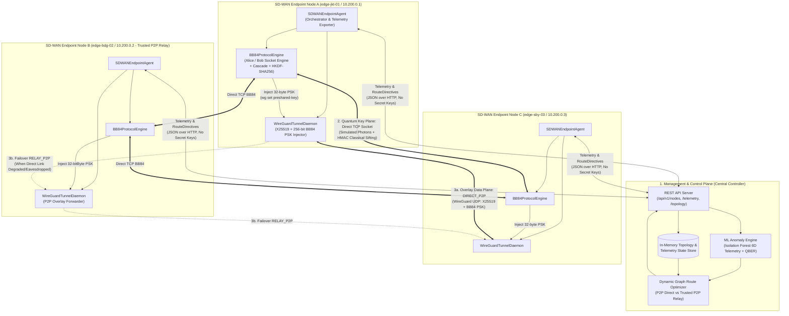
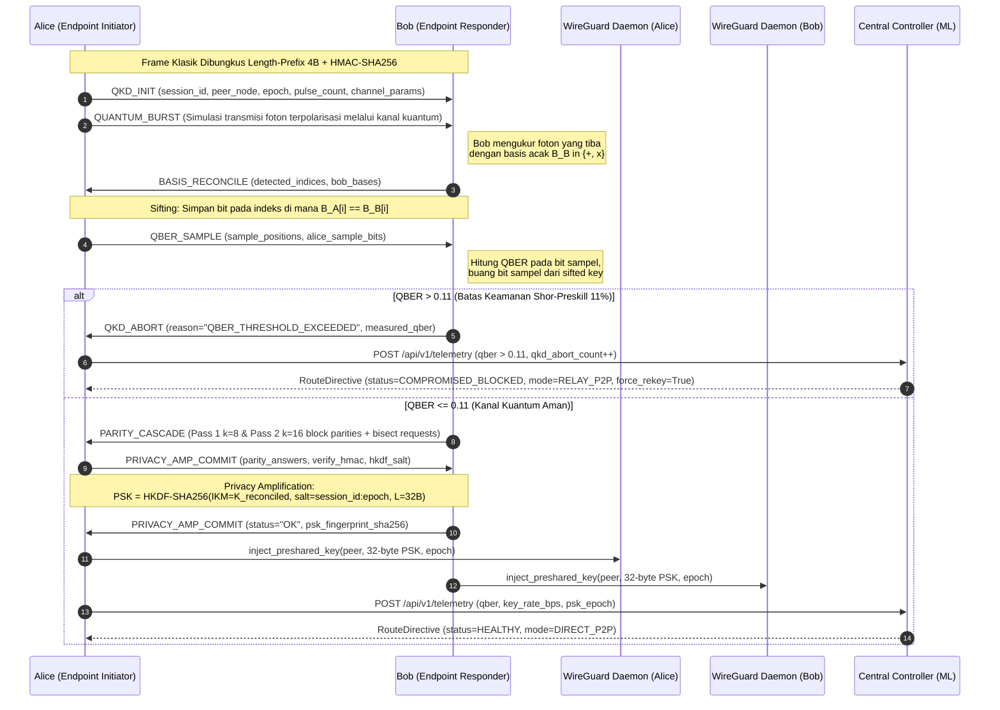
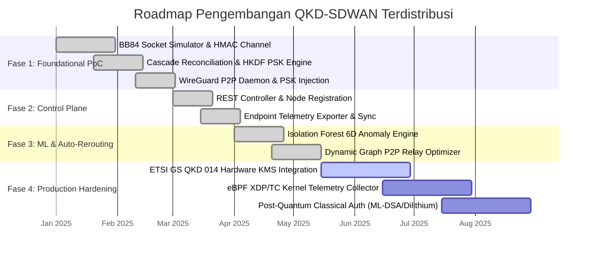

# Blueprint Arsitektur & Spesifikasi Teknis: Distributed P2P SD-WAN dengan Simulasi QKD BB84 dan Mesin Inferensi Machine Learning

## 1. Ringkasan Eksekutif

Dokumen ini menyajikan rancangan arsitektur menyeluruh, spesifikasi protokol, formulasi matematis, dan roadmap implementasi **Proof-of-Concept (PoC) Software-Defined Wide Area Network (SD-WAN) Terdistribusi** yang menggabungkan:

1. **Simulasi Distribusi Kunci Kuantum (QKD) Protokol BB84 Berbasis Soket** langsung antar *endpoint* (Peer-to-Peer) dengan autentikasi kanal klasik HMAC-SHA256, koreksi kesalahan paritas blok **Cascade 2-Pass**, dan *privacy amplification* berbasis **HKDF-SHA256**.
2. **Enkripsi Data-Plane Peer-to-Peer (P2P) berbasis WireGuard** yang mempertahankan pertukaran kunci asimetris Curve25519 (X25519) dan menyuntikkan kunci simetris 256-bit hasil negosiasi BB84 ke dalam slot `PresharedKey` (PSK) secara berkala untuk ketahanan *post-quantum* (*hybrid quantum-classical security*).
3. **Central Controller Berbasis Machine Learning** yang mengumpulkan telemetri kualitas jaringan underlay serta parameter kuantum (**Quantum Bit Error Rate / QBER**, *key generation rate*, latensi, jitter, *packet loss*), mendeteksi anomali trafik maupun upaya penyadapan kuantum (*intercept-resend eavesdropping*) menggunakan **Isolation Forest**, dan mengoptimalkan rute overlay P2P (`DIRECT_P2P` vs `RELAY_P2P`) tanpa pernah menerima trafik data ataupun kunci sesi BB84.

---

## 2. Arsitektur Sistem & Pemisahan Tiga Plane

Prinsip utama arsitektur ini adalah **Zero-Trust Key & Data Separation**: Central Controller hanya bertindak sebagai bidang kendali (*Control & Management Plane*) dan mesin analitik ML, sedangkan seluruh negosiasi kunci kuantum BB84 (*Quantum Key Negotiation Plane*) serta pengiriman paket aplikasi terenkripsi (*Overlay Data Plane*) berlangsung **murni secara Peer-to-Peer (P2P)** antar *endpoint*.

### 2.1 Diagram Arsitektur Tiga Plane



### 2.2 Karakteristik Tiap Plane

| Plane | Komponen Utama | Protokol & Transpor | Sifat Topologi | Data yang Melewati |
| :--- | :--- | :--- | :--- | :--- |
| **1. Management & Control Plane** | `SDWANControllerServer`, `IsolationForestDetector`, `OverlayRouteOptimizer` | HTTP/REST JSON (`ThreadingHTTPServer`) | Hub-and-Spoke (Hanya Metadata & Kebijakan) | Registrasi node, metrik kualitas link, QBER, skor anomali ML, `RouteDirective` (`DIRECT_P2P`, `RELAY_P2P`, `QUARANTINED`). **Kunci BB84 tidak pernah dikirim ke Controller.** |
| **2. Quantum Key Negotiation Plane** | `BB84ProtocolEngine` (`Alice` Initiator & `Bob` Responder) | TCP Socket Berbingkai 4-Byte Length-Prefixed + Autentikasi HMAC-SHA256 | **Murni Peer-to-Peer (P2P)** langsung antar *endpoint* | Pulsa foton terpolarisasi (simulasi kanal kuantum), indeks deteksi basis, sampel estimasi QBER, paritas blok Cascade, komitmen HKDF. |
| **3. Overlay Data Plane** | `WireGuardTunnelDaemon` (`KERNEL_WG` / `USERSPACE_CRYPTO_WG`) | UDP (WireGuard / X25519 ECDH + BB84 256-bit PSK + ChaCha20-Poly1305) | **Murni Peer-to-Peer (P2P)** (`DIRECT_P2P` atau 2-hop `RELAY_P2P` antar *endpoint*) | Paket payload aplikasi terenkripsi ujung-ke-ujung dan probe pengukuran RTT/loss. |

---

## 3. Spesifikasi Protokol QKD BB84 & Penyuntikan Kunci WireGuard

### 3.1 Model Fisik Kanal Kuantum yang Disimulasikan

Pada `BB84ProtocolEngine`, pengiriman foton dari **Alice** ke **Bob** sepanjang serat optik berjarak $L$ km dimodelkan dengan tiga fenomena fisik kuantum:

1. **Atenuasi Serat Optik ($\alpha$ dB/km)**:
   Probabilitas sebuah pulsa foton berhasil mencapai detektor Bob tanpa terserap serat optik adalah:
   $$\eta_{\text{trans}} = 10^{-\frac{\alpha \cdot L}{10}}$$
   Untuk default $L = 15\text{ km}$ dan $\alpha = 0.2\text{ dB/km}$, $\eta_{\text{trans}} = 10^{-0.3} \approx 50.12\%$.

2. **Penyadapan *Intercept-Resend* oleh Eve ($\eta_{\text{eve}} \in [0, 1]$)**:
   Jika penyadap (Eve) mengintersepsi fraksi $\eta_{\text{eve}}$ dari foton yang melintas:
   - Eve memilih basis pengukuran acak $B_E \in \{+ (0), \times (1)\}$ dengan probabilitas seragam $1/2$.
   - Dengan probabilitas $1/2$, basis Eve cocok dengan basis Alice ($B_E = B_A$), sehingga state foton yang dikirim ulang ke Bob tidak terganggu.
   - Dengan probabilitas $1/2$, basis Eve salah ($B_E \neq B_A$), sehingga foton terproyeksi ke basis yang salah. Ketika Bob nantinya mengukur pada basis yang sama dengan Alice ($B_B = B_A$), hasil ukur Bob memiliki peluang salah sebesar $1/2$.
   - Akibatnya, penyadapan *intercept-resend* menyumbang kenaikan QBER teoretis sebesar:
     $$\Delta\text{QBER}_{\text{eve}} = \frac{\eta_{\text{eve}}}{4}$$

3. **Depolarisasi Kanal & *Dark Count* Detektor ($p_{\text{noise}}$)**:
   Ketidaksempurnaan komponen optik dan derau termal detektor dimodelkan sebagai kanal depolarisasi simetris dengan probabilitas *bit-flip* alami $p_{\text{noise}} \approx 0.015$ ($1.5\%$). Ekspektasi total QBER yang terukur pada sampel sifted key adalah:
   $$\mathbb{E}[\text{QBER}] = p_{\text{noise}}(1 - \Delta\text{QBER}_{\text{eve}}) + (1 - p_{\text{noise}})\Delta\text{QBER}_{\text{eve}} \approx p_{\text{noise}} + \frac{\eta_{\text{eve}}}{4}$$

### 3.2 Diagram Urutan Protokol Negosiasi BB84 & Injeksi PSK



### 3.3 Struktur Frame Protokol Negosiasi BB84

Setiap pesan pada kanal klasik TCP dibingkai dengan header panjang 4-byte *unsigned big-endian integer* (`!I`), diikuti dokumen JSON UTF-8 yang memuat tag autentikasi HMAC-SHA256:

```
+-----------------------------------+---------------------------------------------------+
| Frame Length (4 Bytes, uint32 BE) | JSON Envelope UTF-8 Payload (N Bytes)             |
+-----------------------------------+---------------------------------------------------+
```

Skema JSON Envelope pada kanal klasik BB84:

```json
{
  "msg_type": "QKD_INIT | QUANTUM_BURST | BASIS_RECONCILE | QBER_SAMPLE | PARITY_CASCADE | PRIVACY_AMP_COMMIT | QKD_ABORT",
  "session_id": "bb84-9f8e7d6c5b4a",
  "sender_node": "edge-jkt-01",
  "timestamp": 1730000000.123,
  "payload": {
    "...": "Field spesifik tahapan protokol"
  },
  "hmac_sha256": "64-char hex digest dari canonical JSON (msg_type, session_id, sender_node, timestamp, payload)"
}
```

| `msg_type` | Pengirim | Field `payload` Utama | Deskripsi |
| :--- | :--- | :--- | :--- |
| `QKD_INIT` | Alice | `epoch`, `pulse_count`, `sample_fraction`, `qber_abort_threshold` | Inisialisasi sesi negosiasi kunci baru untuk epoch rotasi tertentu. |
| `QUANTUM_BURST` | Alice | `transmitted_pulses` (indeks foton lolos atenuasi beserta state polarisasi pasca-kanal) | Representasi kedatangan pulsa foton pada detektor optik Bob. |
| `BASIS_RECONCILE` | Bob | `detected_indices: list[int]`, `bob_bases: list[int]` | Pengumuman publik indeks foton yang terdeteksi detektor Bob beserta basis ukur $B_B$. |
| `QBER_SAMPLE` | Alice | `sifted_positions: list[int]`, `sample_indices: list[int]`, `sample_bits: list[int]` | Indeks yang memiliki kecocokan basis ($B_A = B_B$) dan nilai bit sampel untuk uji QBER. |
| `PARITY_CASCADE` | Bob | `measured_qber: float`, `pass1_parities: list[int]`, `pass2_parities: list[int]` | Laporan QBER (< 11%) dan daftar paritas blok Pass-1 ($k_1=8$) & Pass-2 ($k_2=16$). |
| `PRIVACY_AMP_COMMIT` | Alice / Bob | `error_positions: list[int]`, `verify_tag: str`, `psk_fingerprint_sha256: str` | Posisi bit yang dikoreksi melalui *bisect* paritas, tag verifikasi rekonsiliasi, dan komitmen HKDF. |
| `QKD_ABORT` | Alice / Bob | `abort_reason: str`, `measured_qber: float` | Pembatalan darurat sesi BB84 akibat $\text{QBER} > 0.11$, kurangnya *sifted bits*, atau kegagalan rekonsiliasi. |

### 3.4 Derivasi Kunci Kriptografi & Penyuntikan PSK WireGuard

Setelah tahap **Cascade Information Reconciliation** menghasilkan barisan bit terkoreksi $K_{\text{reconciled}}$ yang identik di Alice dan Bob, dilakukan **Privacy Amplification** menggunakan `HKDF-SHA256` untuk menghapus informasi parsial yang mungkin bocor ke Eve melalui transmisi foton maupun pertukaran bit paritas di kanal klasik:

$$\text{PSK}_{t} = \text{HKDF-SHA256}\left(\text{IKM} = K_{\text{reconciled}}, \text{salt} = \text{session\_id} \parallel \text{":"} \parallel \text{epoch}, \text{info} = \texttt{"qkd-sdwan-wireguard-psk"}, L = 32\text{ bytes}\right)$$

Kunci $\text{PSK}_{t}$ (256-bit) kemudian disuntikkan ke daemon WireGuard:
1. **Mode Kernel (`KERNEL_WG`)**: Mengeksekusi perintah standar:
   ```bash
   wg set <interface_name> peer <peer_x25519_public_key> preshared-key /dev/stdin
   ```
   dengan mengalirkan `base64(PSK_t)` melalui `stdin` (sehingga kunci rahasia tidak pernah muncul pada argumen baris perintah `ps` atau file sementara di disk).
2. **Mode Userspace Kriptografis (`USERSPACE_CRYPTO_WG`)**: Menurunkan kunci AEAD sesi `ChaCha20-Poly1305` dari gabungan *shared secret* ECDH Curve25519 ($\text{ECDH}(sk_A, pk_B)$) dan $\text{PSK}_{t}$ hasil BB84:
   $$\text{Key}_{\text{AEAD}} = \text{HKDF-SHA256}\left(\text{IKM} = \text{X25519}(sk_A, pk_B), \text{salt} = \text{PSK}_{t}, \text{info} = \texttt{"wg-qkd-p2p-aead"}, L = 32\text{ bytes}\right)$$

---

## 4. Spesifikasi Mesin Inferensi Machine Learning & Optimasi Rute P2P

### 4.1 Vektor Fitur Telemetri 6-Dimensi

Setiap siklus telemetri dari node $u$ ke node $v$ menghasilkan vektor fitur $x_{uv} \in \mathbb{R}^6$:

$$x_{uv} = \begin{bmatrix} x_1 \\ x_2 \\ x_3 \\ x_4 \\ x_5 \\ x_6 \end{bmatrix} = \begin{bmatrix} \text{qber} \\ \Delta\text{qber} \\ \text{key\_rate\_bps} \\ \text{latency\_ms} \\ \text{jitter\_ms} \\ \text{packet\_loss\_pct} \end{bmatrix}$$

### 4.2 Deteksi Anomali dengan Isolation Forest

`IsolationForestDetector` membangun ensemble berisi $T = 64$ pohon isolasi acak (`_IsolationTree`) dengan kapasitas subsample $\psi = 128$ dari distribusi telemetri jaringan sehat. Panjang jalur rata-rata (*average path length*) $E(h(x))$ dari akar ke daun tempat sampel $x$ terisolasi dinormalisasi terhadap konstanta pohon pencarian biner (BST):

$$c(\psi) = 2 H(\psi - 1) - \frac{2(\psi - 1)}{\psi}, \quad \text{di mana } H(k) = \ln(k) + \gamma \quad (\gamma \approx 0.5772156649)$$

Skor anomali Isolation Forest dihitung sebagai:

$$s_{\text{IF}}(x, \psi) = 2^{-\frac{E(h(x))}{c(\psi)}} \in (0, 1]$$

Untuk memperkuat kepekaan terhadap pergeseran distribusi ekstrim pada dimensi fisik maupun kuantum, skor Isolation Forest dikombinasikan dengan deviasi *z-score* terboboti terhadap baseline normal sehingga menghasilkan `anomaly_score` akhir $s \in (0, 1]$.

#### Aturan Keputusan Klasifikasi Status Link (`LinkStatus`)

| Status Link (`LinkStatus`) | Kondisi Pemicu Kuantum & ML | Tindakan Keamanan & Routing |
| :--- | :--- | :--- |
| `COMPROMISED_BLOCKED` | $\text{QBER} > 0.11$ **atau** `qkd_abort_count > 0` | Batalkan sesi BB84, tolak rotasi kunci pada link langsung, blokir link langsung ($C(u,v) = 10^6$), paksa pengalihan ke `RELAY_P2P` (atau `QUARANTINED` jika tidak ada relay sehat) dengan `force_rekey = True`. |
| `EAVESDROPPING_SUSPECTED` | $0.065 \le \text{QBER} \le 0.11$ **atau** ($s \ge 0.65$ dan $\Delta\text{QBER} > 0.03$) | Indikasi penyadapan parsial di bawah batas abort; aktifkan `force_rekey = True` untuk mempercepat rotasi PSK dan alihkan trafik ke jalur `RELAY_P2P` yang sehat. |
| `DEGRADED_UNDERLAY` | $\text{QBER} < 0.065$ namun ($s \ge 0.62$ **atau** $\text{loss} > 3.0\%$ **atau** $\text{latency} > 80.0\text{ ms}$) | Kanal kuantum aman tetapi kualitas jaringan WAN menurun; alihkan trafik data-plane ke `RELAY_P2P` jika jalur relay memiliki biaya total lebih rendah. |
| `HEALTHY` | $\text{QBER} < 0.065$, $s < 0.62$, $\text{loss} \le 3.0\%$, $\text{latency} \le 80.0\text{ ms}$ | Pertahankan komunikasi langsung `DIRECT_P2P` antar endpoint. |

### 4.3 Fungsi Biaya Multi-Objektif & Optimasi Rute Overlay P2P

`OverlayRouteOptimizer` memodelkan jaringan overlay sebagai graf berarah berbobot $G = (V, E)$. Untuk setiap pasangan berarah $(u, v) \in E$, biaya link langsung dihitung sebagai:

$$C(u, v) = \begin{cases} 10^6 & \text{jika } \text{status}_{uv} = \texttt{COMPROMISED\_BLOCKED} \\[6pt] 1.0 \cdot \text{latency}_{uv} + 2.5 \cdot \text{jitter}_{uv} + 18.0 \cdot \text{loss}_{uv} \\ \quad + 1200.0 \cdot \max(0, \text{QBER}_{uv} - 0.04) + 150.0 \cdot \max(0, s_{uv} - 0.55) & \text{lainnya} \end{cases}$$

Pemilihan rute antara $(u, v)$ dilakukan dengan algoritma berikut:
1. **Prioritas P2P Langsung**: Jika $\text{status}_{uv} = \texttt{HEALTHY}$, terbitkan `RouteDirective` dengan `route_mode = DIRECT_P2P` dan `next_hop_node = v`.
2. **Pencarian Relay P2P Tepercaya**: Jika $\text{status}_{uv} \neq \texttt{HEALTHY}$, cari node perantara $w \in V \setminus \{u, v\}$ sedemikian sehingga:
   $$\text{status}_{uw} = \texttt{HEALTHY} \;\wedge\; \text{status}_{wv} = \texttt{HEALTHY} \;\wedge\; \left(C(u, w) + C(w, v) + \delta_{\text{hysteresis}} < C(u, v)\right)$$
   dengan margin histeresis $\delta_{\text{hysteresis}} = 15.0$ untuk mencegah *route flapping*. Node $w^*$ yang meminimalkan $C(u, w) + C(w, v)$ dipilih sebagai `next_hop_node` pada mode `RELAY_P2P`.
3. **Karantina Keamanan**: Jika $\text{status}_{uv} = \texttt{COMPROMISED_BLOCKED}$ dan tidak ditemukan node relay $w$ yang sehat, link ditempatkan pada `route_mode = QUARANTINED`.

---

## 5. Kontrak REST API Central Controller

Central Controller mengekspos endpoint HTTP JSON berikut:

### 5.1 `GET /api/v1/health`
Memeriksa kesehatan layanan Controller.
- **Response `200 OK`**:
```json
{
  "status": "ok",
  "registered_nodes": 3,
  "active_directives": 6
}
```

### 5.2 `POST /api/v1/nodes/register`
Mendaftarkan identitas endpoint SD-WAN dan kunci publik WireGuard X25519 miliknya.
- **Request Body**:
```json
{
  "node_id": "edge-jkt-01",
  "overlay_ip": "10.200.0.1",
  "underlay_host": "127.0.0.1",
  "wg_port": 51821,
  "qkd_port": 52821,
  "wg_public_key": "Base64Encoded32ByteX25519PublicKey=========",
  "auth_token_id": "hmac-cluster-key-01",
  "registered_at": 1730000000.0
}
```
- **Response `200 OK`**: Mengembalikan objek `node` terdaftar dan daftar `peers` aktif di klaster.

### 5.3 `POST /api/v1/telemetry`
Mengirimkan laporan telemetri link P2P dan metrik sesi BB84 dari endpoint ke Controller, lalu memicu evaluasi ML dan perhitungan ulang rute.
- **Request Body (`LinkTelemetry`)**:
```json
{
  "source_node": "edge-jkt-01",
  "target_node": "edge-sby-03",
  "timestamp": 1730000010.5,
  "latency_ms": 14.2,
  "jitter_ms": 1.1,
  "packet_loss_pct": 0.1,
  "throughput_mbps": 420.0,
  "qber": 0.016,
  "qber_delta": 0.001,
  "key_rate_bps": 6400.0,
  "psk_epoch": 1,
  "handshake_age_s": 2.4,
  "qkd_abort_count": 0
}
```
- **Response `200 OK`**:
```json
{
  "status": "evaluated",
  "evaluation": {
    "anomaly_score": 0.412,
    "link_status": "HEALTHY",
    "reason": "Quantum and underlay metrics within normal baseline"
  },
  "directive": {
    "source_node": "edge-jkt-01",
    "target_node": "edge-sby-03",
    "route_mode": "DIRECT_P2P",
    "next_hop_node": "edge-sby-03",
    "next_hop_endpoint": "127.0.0.1:51823",
    "anomaly_score": 0.412,
    "link_status": "HEALTHY",
    "force_rekey": false,
    "reason": "Direct P2P link healthy",
    "updated_at": 1730000010.51
  }
}
```

### 5.4 `GET /api/v1/topology/{node_id}`
Mengambil daftar seluruh peer terdaftar dan `RouteDirective` aktif yang berasal dari `{node_id}`.

### 5.5 `GET /api/v1/cluster/status`
Mengambil snapshot lengkap seluruh node, metrik telemetri terakhir, skor anomali ML, status link, dan tabel direktif rute di seluruh klaster SD-WAN.

---

## 6. Roadmap Pengembangan Bertahap



1. **Fase 1 — Foundational PoC & Socket Simulation**:
   - Implementasi simulator transmisi foton BB84 berbasis soket TCP (`BB84ProtocolEngine`), kanal klasik terautentikasi HMAC-SHA256, *basis sifting*, estimasi QBER dengan batas keamanan 11% Shor-Preskill, koreksi kesalahan paritas blok **Cascade 2-Pass**, *privacy amplification* **HKDF-SHA256**, dan injeksi kunci 256-bit ke `PresharedKey` WireGuard (`WireGuardTunnelDaemon`).
2. **Fase 2 — Control Plane & Telemetry Pipeline**:
   - Implementasi `SDWANControllerServer` dan `SDWANEndpointAgent` untuk registrasi node dinamis, penemuan peer P2P, serta pengumpulan metrik latensi, jitter, *packet loss*, QBER, dan *key rate* secara berkala.
3. **Fase 3 — ML Anomaly Detection & Dynamic P2P Rerouting**:
   - Integrasi `IsolationForestDetector` dan `OverlayRouteOptimizer` untuk membedakan antara gangguan jaringan WAN biasa (`DEGRADED_UNDERLAY`), indikasi awal penyadapan kuantum (`EAVESDROPPING_SUSPECTED`), dan kompromi penuh kanal kuantum (`COMPROMISED_BLOCKED`), disertai pengalihan trafik P2P otomatis melalui peer relay tepercaya (`RELAY_P2P`).
4. **Fase 4 — Hardware QKD ETSI GS QKD 014 & Kernel eBPF Production Hardening**:
   - Mengganti modul simulasi soket kuantum dengan konektor standar **ETSI GS QKD 014** (`Get_Key` / `Get_Key_with_Key_IDs` melalui HTTPS mTLS ke perangkat QKD fisik seperti ID Quantique / Toshiba), mengganti autentikasi pre-shared HMAC dengan tanda tangan digital pasca-kuantum **FIPS 204 ML-DSA (Dilithium)**, serta memindahkan pengumpulan telemetri overlay ke *hook* kernel **eBPF TC/XDP**.
